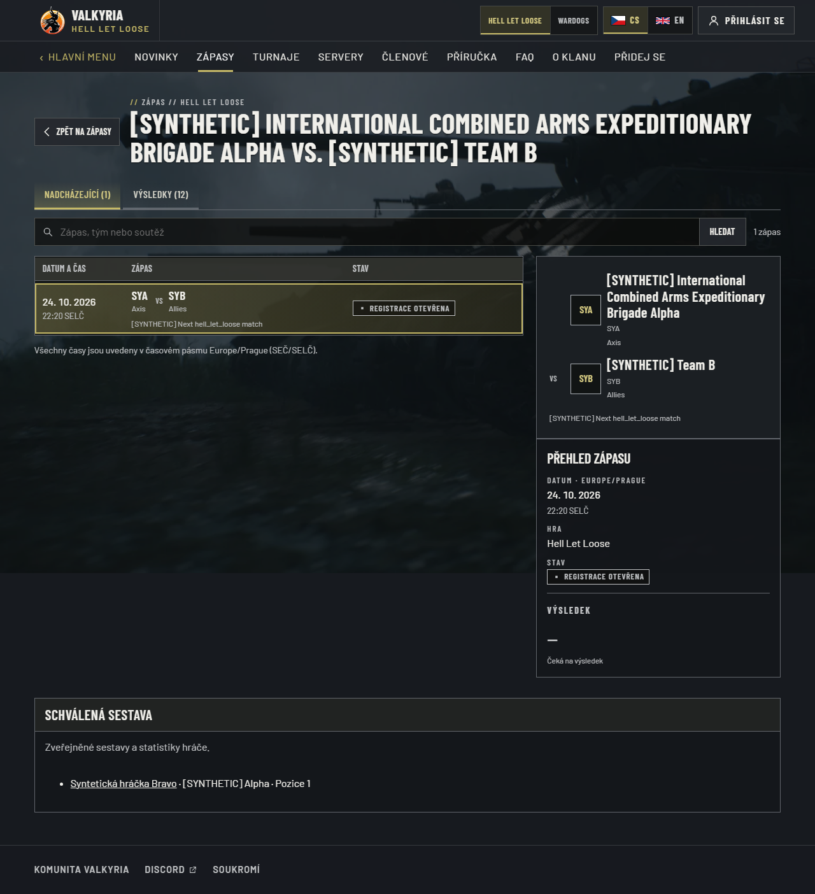
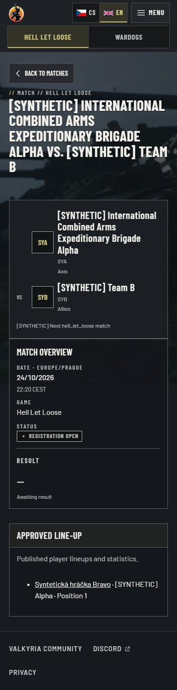

# Native match detail readability — 24 October 2026

Production acceptance of #116 found that the first captured team in a native HLL
banner occupied the narrow VS column. Its preceding accessible teams prefix meant
the old `:first-child` selector never matched. A long actual team name consequently
wrapped into single letters. All banner teams now explicitly occupy the content
column; VS keeps its own column. List rows and the accessible prefix are preserved.

The same acceptance review found that a linked historical detail still displayed
its archived placeholder kickoff while its list row used the current Logi timestamp.
The preview and canonical detail now use the identical supplied start/end semantics
as the list, including an explicit end-time label when no start exists. Underlying
archive dates, scores, publication and consent remain unchanged.

The actual Wardogs 10 October record supplies a three-team event title and three
faction results, but only two captured team records. For this narrow unlinked WDG
case, the original event title remains primary and every captured team is secondary
under “Supplied teams”, without VS. The renderer neither invents the missing team
nor attributes faction scores to clans. Complete captures and archive links retain
their existing presentation.

## Reproduction and proof

Tested application tree `6bd5262995a338555b46c76bac8ecf368b877e54`, based on
`eea874591543461f31b905e7b67c3cd67add8764`. Windows/Node24/pnpm10.34.5,
standalone production build, Playwright Chromium, disposable loopback PostgreSQL
and explicitly synthetic projections. Independent integrated review: no findings.

`pnpm build`, full lint/typecheck and all 1,388 unit tests passed. The 39 focused
identity/rendering cases include the exact partial-WDG contradiction in both locales,
checking primary/secondary order, retained data, absent VS and unchanged faction scores.
`CAPTURE_EVIDENCE=1 pnpm --filter @valkyria/web exec playwright test -c playwright.logi.config.ts`
passed **25/25** journeys. Four new CS/EN ×1280/390 cases measure both team-track
widths/alignment, long-name rendered line count, clipping and VS placement. Existing
linked-history journeys compare list/preview/canonical datetimes and retain the
consented lineup and denied-statistics assertions. These are layout/behavior checks,
not assertions that only mirror the CSS rule.

`/cs/hll/matches/logi/synthetic-next-hell_let_loose`, 1280×900 viewport, full document:
the first name wraps into readable lines beside its mark; the second name aligns
with it and VS remains separate. Supplied start/status and the consented synthetic
lineup remain visible.

The same native detail at `/en/…`, 390×844 viewport, full document: readable team
names, no text clipping or horizontal overflow, and an honest awaiting-result state.

This correction was included in the combined accepted production source
`076ba9316ff0f8433dc01efc916a5962ca7ac184` after full exact-head/main/publisher
qualification. Actual long-name geometry, matching linked timestamps and inspected
production screenshots are in the [final acceptance record](../match-production-final-2026-10-24/README.md).
The seven reviewed recent HLL identity associations were activated
independently at 19:11:39 UTC and passed 117 public checks. The unresolved legacy
opponent331 was corrected to Kebaguettes & Bayonets / K&B using captured data and the
current public legacy match209, with an audit record and no score/date/publication
change. No runtime matching heuristic is added.
