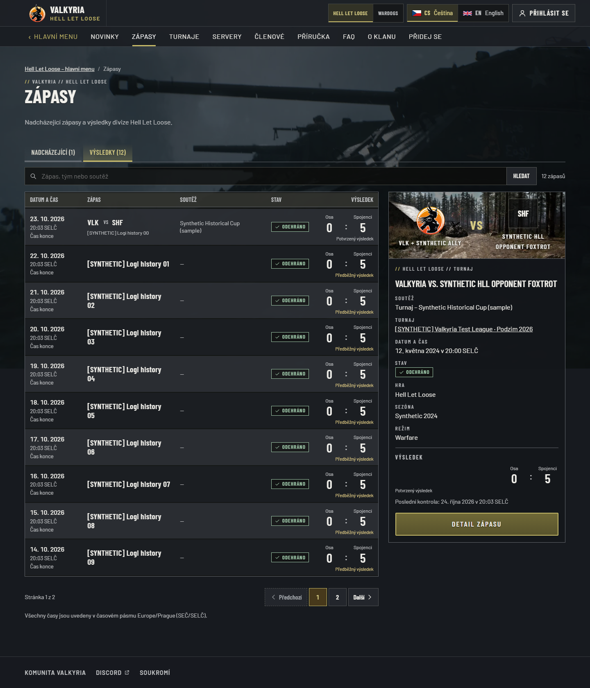
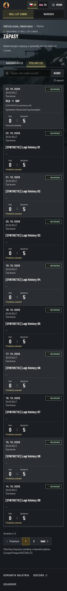
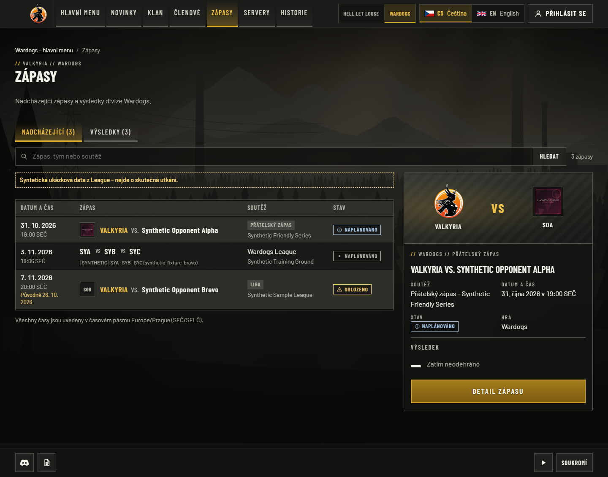
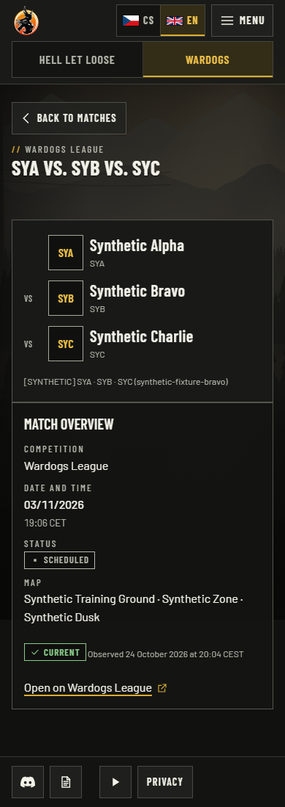

# Shared match presentation — 24 October 2026

The reported reproduction showed separate Logi and website-history sections. The
previous production release already combined those rows, but native/League details,
scores and organizer fixtures still had inconsistent presentation. This follow-up
uses one chronological browser, search, counters and pagination for approved native,
editorial and eligible League matches, including the primary all-games browser.

## Local qualification

Tested application subtree: `aaaf40e4ef681f7d4a8ba3240220bc2772cc642e`
on `fix/match-presentation`, based on main `83aa6ebb935dd84dfa67e8ca0c3629befe4b66f6`.
The PR commit links this exact application tree to the complete source revision.
Windows, Node 24, pnpm 10.34.5, standalone production build and Playwright Chromium;
loopback PostgreSQL and labelled synthetic fixtures/mock providers only.

| Command / scenario | Observed result |
| --- | --- |
| `pnpm test:unit` | 1,383 tests / 123 files passed |
| `pnpm test:integration` with disposable PostgreSQL | 549 tests / 52 files passed |
| `pnpm lint`, `pnpm typecheck`, `pnpm build` | Passed |
| `playwright test -c playwright.logi.config.ts` | 21 connected projection journeys passed, CS/EN, desktop/mobile |
| `playwright test e2e/public-matches.spec.ts e2e/wardogs-league-fixtures.spec.ts e2e/visual-wardogs-readers.spec.ts e2e/public-layout.spec.ts --project=chromium --workers=2` | 62 passed with evidence capture enabled |
| Independent integrated source review | No remaining actionable findings |

The connected suite asserts canonical archive redirects retain the sole consented
historical lineup, while denied identities/statistics and attendance remain absent.
Mixed-source unit/browser scenarios cover exact-once rows, every page, all-games/game
filters, query, zero/null/multiple participants, missing dates, stale organizers and
paused/unpublished bindings. Faction scores retain faction labels; missing provider
scores remain awaiting result. Existing public bounds and privacy gates are unchanged.

## Inspected captures

These are real local captures, not production proof. Full-page screenshots preserve
the actual rendered document. Synthetic names are intentionally visible.

`/cs/hll/matches?view=results`, 1440px viewport: one list and search, prominent labelled
scores, one reviewed canonical match link and the shared rich preview.

The same route at 390px: each result keeps its date, participants, status and labelled
score within the viewport; a single pagination control follows the list.

`/cs/wardogs/matches`, 1440×1050 viewport: editorial and eligible three-team League
fixtures share one dated list and count; no second organizer/archive section.

`/en/wardogs/matches/league/synthetic-fixture-bravo`, 390×844 viewport: the common
detail pane retains all three supplied participants, actual map/date/status, freshness
and a secondary organizer link; no invented result.

## Release boundary

Hosted exact-head CI, accepted-main qualification, protected publication and current
production read-back must be recorded on the PR before claiming deployment. This
record does not claim that local fixtures activate Logi's deferred Convex producer.
No SQL migration, environment, dependency or provider-permission change is required.
