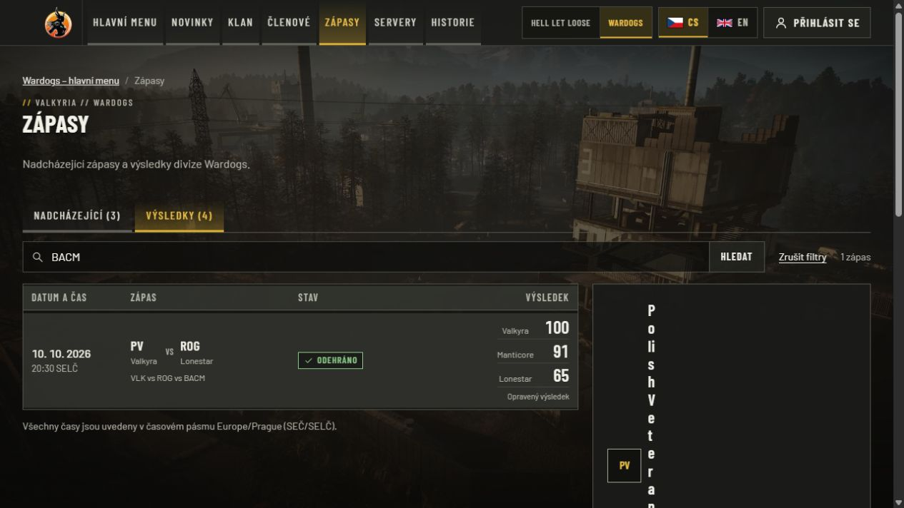
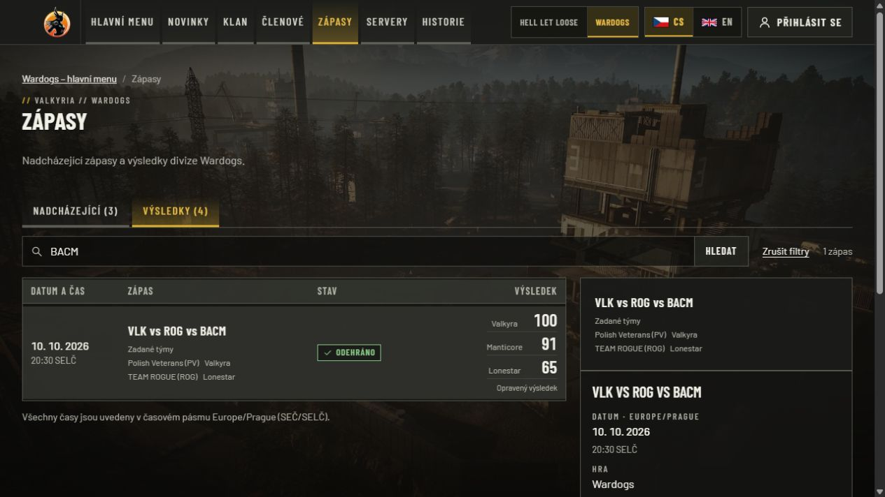
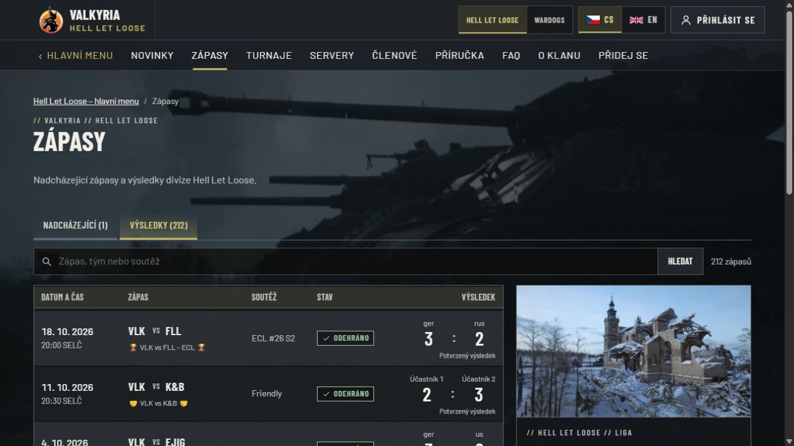
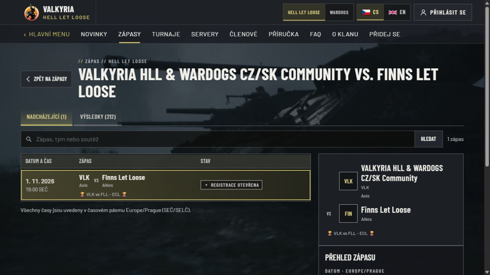
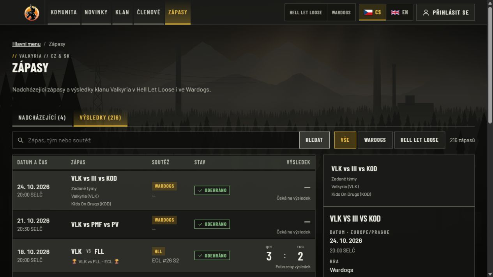

# Unified match browser — final production acceptance, 24 October 2026

Production application source is `076ba9316ff0f8433dc01efc916a5962ca7ac184`,
application tree `7e8c329c77a69289e134888e41afa54eafa788a4`, activated at
20:40:17.465 UTC, ready at 20:40:21 UTC. The running immutable image is
`majorluk/valkyria-www@sha256:76d5083d360bf82dc70a267a7076d86fd406ffaf8d2de5f2e1c71c8f891ee52a`.

HLL, Wardogs and the shared community page use one chronological match browser,
search, counts, pagination and detail composition. Native, reviewed historical and
eligible League fixtures share the same presentation. Result labels preserve actual
participants/factions and pending/provisional/confirmed/corrected states. Unlinked
native Wardogs matches keep the exact supplied event title primary and all captured teams secondary;
neither a missing team nor score attribution is invented. HLL long names occupy the
wide banner track. Linked list, preview and canonical detail use the same supplied
start/end timestamp. Consented historical lineups retain their canonical links.

## Qualified release

- [PR #118](https://github.com/ValkyriaWDG/www/pull/118), exact head
  `733df307868882f34ca5fd369a97430966ca233e`, base `360ffe2e822c0cbd41d32d13f09078d2c36da1f9`:
  [CI 40127278162](https://github.com/ValkyriaWDG/www/actions/runs/40127278162) passed.
- [Accepted-main CI 40128878521](https://github.com/ValkyriaWDG/www/actions/runs/40128878521)
  and the complete reusable verification of
  [protected publisher 40128893567](https://github.com/ValkyriaWDG/www/actions/runs/40128893567)
  passed for the exact deployed source. Publication was approved after both Quality
  gates and current authenticated registry visibility matched the approved public repository.
- Full lint/types/build, 1,395 unit tests, 549 PostgreSQL integration tests, real
  restore, non-root image/native sharp/previous-image rollback rehearsal, vulnerability
  comparison and SBOM passed. Browser acceptance: 274 ordinary tests passed, 166 opt-in
  cases skipped; 29 CI synthetic connected CS/EN desktop/mobile journeys and four artwork cases passed.
  Cold mobile budgets passed. Independent integrated source review had no findings.
  Detailed CI artifacts retain 90 days; selected captures here are durable.
- Explicit production migration applied 0 changes, with 13 already applied. Fresh paired recovery restored
  37 tables and 442 media files; encrypted off-host recovery passed authenticated
  AES-GCM decryption and hashes. Only the website was paused for 10.39 seconds during
  that recovery capture. Compatible image rollback preserves newer live writes.

## Actual production read-back

At 20:41:17 UTC and again at 20:54:58 UTC, **143/143 public checks passed** across both locales, both games,
primary views, actual detail/media links, filters/pagination, authentication guards,
invalid requests and old-domain redirects including query preservation. No tested
response leaked configured secrets or internal connection IDs. A further **12/12
regression checks** on the actual running container passed at 20:48:07 UTC: one browser/
search per match page, absent old source/archive headings, matching canonical HLL
timestamp and both completed/pending Wardogs source identities with unchanged scores.

Actual image/OCI source, readiness and healthy state were read back. Runtime
configuration and Logi server source, 442 media hashes, 17 other container identities/
start times and all three publication/sync/backup timers were preserved. The owned
candidate was removed; the dedicated updater resumed at 20:48:29 UTC. Its first natural
poll completed at 20:53:39 UTC with failed=0, scanned=1 and updated=0. The website
retained the same container identity/start time and remained healthy at the
20:55:29 UTC observation. The full acceptance is maintained in the
[production acceptance record](https://github.com/ValkyriaWDG/www/pull/118#issuecomment-6389379633).

Seven independently reviewed HLL native/archive identity associations removed seven
duplicate copies across upcoming/results. The unresolved public legacy opponent 331
was corrected to Kebaguettes & Bayonets / K&B with an operator audit record, using
captured data and the public legacy match 209. Scores, dates and publication were
preserved. Two existing Wardogs League fixtures for 24/25 October were explicitly
linked to their matching native events in Logi's admin UI, persisted after reload
and removed two further duplicate copies. No runtime identity heuristic was added.

Actual Chromium interaction passed search submissions for PMF/BACM, CS/EN Wardogs
details, an awaiting-result event, shared game filters and page 2. Visible totals were
212 HLL / 4 WDG / 216 combined results. Actual long HLL team tracks measured 304px each;
the long first name used 247px and two lines, with no horizontal overflow. The linked
HLL preview displayed the list's 20:00 kickoff.

Real existing-account Logi SSO passed on this image. Both authorized private teams
showed current synchronized data: 128 members / seven rosters for HLL and 69 / three for WDG.
Administration offered one operational Logi entry and collapsed archive navigation.
After signing out the newly created test session, the team route returned to login.
Private people, attendance and account state are omitted from public screenshots.

Reproducible qualification/readiness commands (runtime commands require the authorized
operator host; local browser commands require disposable loopback PostgreSQL):

```sh
gh run view 40128878521 --repo ValkyriaWDG/www
gh run view 40128893567 --repo ValkyriaWDG/www
pnpm lint
pnpm typecheck
pnpm test:unit
pnpm test:integration
pnpm build
CAPTURE_EVIDENCE=1 pnpm --filter @valkyria/web exec playwright test -c playwright.logi.config.ts
docker image inspect majorluk/valkyria-www@sha256:76d5083d360bf82dc70a267a7076d86fd406ffaf8d2de5f2e1c71c8f891ee52a
docker exec valkyria-web node -e "fetch('http://127.0.0.1:3000/api/health/ready').then(r=>process.exit(r.ok?0:1))"
```

Migration, recovery and scoped rollout followed the [deployment contract](../../operations/deployment.md).
Full private operator receipts retain the image/configuration, paired restoration,
HTTP regression and preservation reports; they contain no replacement public credentials.

## Inspected anonymous production captures

Actual anonymous production Chromium/IAB captures, logical 1280×720 viewport,
1265px document content width; native capture raster 1265×712 JPEG, without redaction
or image editing. Background video frames can differ between captures. The selected
images were inspected. Responsive CS/EN 390px proof is separately supplied by the
29 CI synthetic connected journeys and [inspected synthetic captures](../wardogs-source-identity-2026-10-24/README.md).



Before, source `eea874591543461f31b905e7b67c3cd67add8764`,
`/cs/wardogs/matches?view=results&q=BACM`: the first captured name wraps vertically
and two supplied teams incorrectly dominate the match identity. This is failure
evidence, not an accepted final state.



Same Czech route after deployment: one filtered row and common rich preview, original
three-team title primary, two explicitly supplied team facts secondary and unchanged
labelled faction scores 100/91/65. No separate source/archive section.



`/cs/hll/matches?view=results`: common history and current matches, one search/count/
pagination, prominent labelled result and canonical preview with the matching time.



`/cs/hll/matches/logi/px79as28v6a3ycv03synqtegvh8gtvnx`: actual long captured names
remain readable in the wide banner track; VS is separate and the result stays pending.



`/cs/matches?view=results`: one mixed chronological list with common game filters,
search and preview. The inspected snapshot retains both games without duplicated
native/League rows for the two explicitly linked fixtures.

The owner deferred Logi Convex activation. Producer collection/parser activation,
Warcon availability and complete bounded historical statistics retain the separate
[producer acceptance limits](../production-2026-10-24/README.md). This website release
does not assert that a missing producer result or live snapshot is available.
