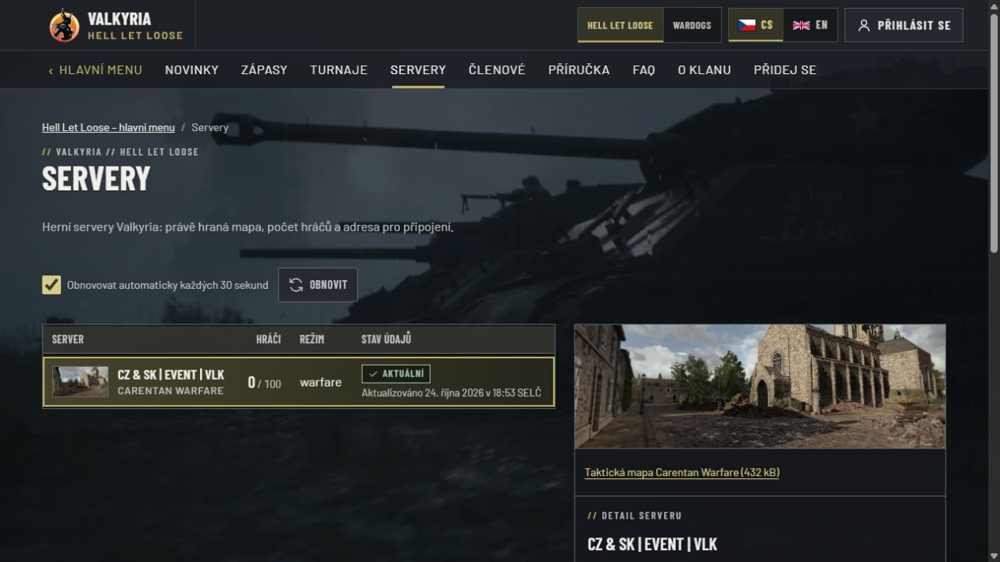
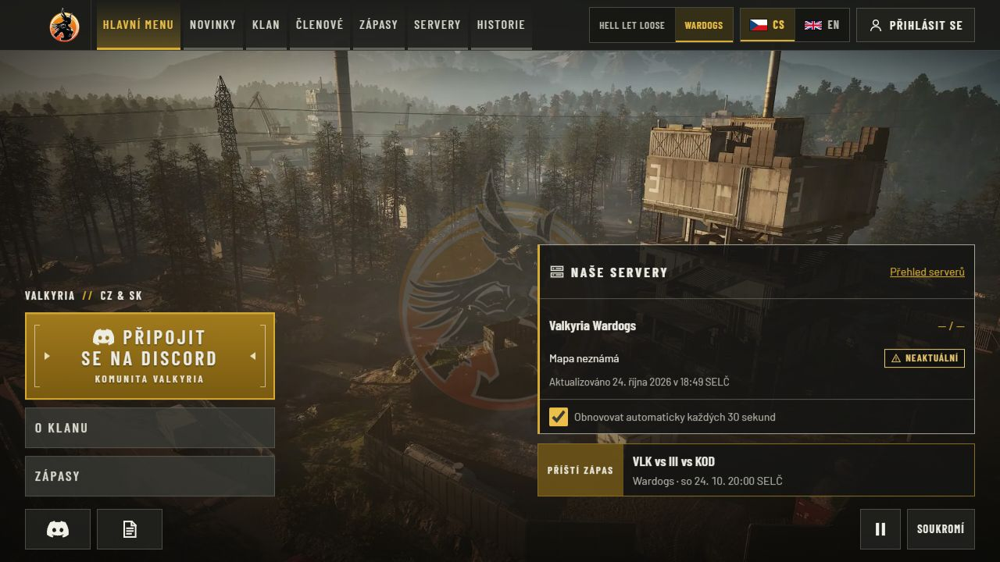
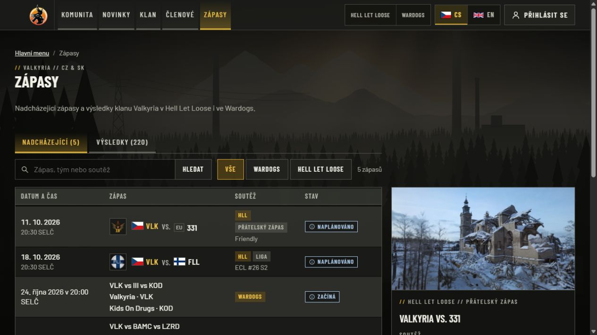

# Unified website production activation — 24 October 2026

The owner authorized merging, production deployment and the necessary Logi settings.
The running website was replaced at **16:46:52 UTC** and readiness passed at
16:46:55 UTC. Later documentation-only revisions do not identify a newer application
image. HLL and Wardogs share this application; the old Wardogs domain redirects here.

| Identity | Accepted value |
| --- | --- |
| Application source | `6647f9a9bae24186d794f8f2826253ad30c29a70` |
| Immutable image | `majorluk/valkyria-www@sha256:56cebfcf9e98e6d25521c1f2805870c895c7e54f3f419785e90fc5223ffdfcf0` |
| Runtime channel | `majorluk/valkyria-www:production`, verified at that exact index digest |
| Website changes | [#112](https://github.com/ValkyriaWDG/www/pull/112), [#113](https://github.com/ValkyriaWDG/www/pull/113), [#114](https://github.com/ValkyriaWDG/www/pull/114), all merged |
| PR-head qualification | [CI 40108591983](https://github.com/ValkyriaWDG/www/actions/runs/40108591983), success |
| Accepted main qualification | [CI 40110179534](https://github.com/ValkyriaWDG/www/actions/runs/40110179534), success |
| Protected publication | [Publisher 40110184315](https://github.com/ValkyriaWDG/www/actions/runs/40110184315), success |

The publisher pulled the immutable image, checked its source label and promoted the
complete OCI index with provenance/SBOM. Migration-bundle and runtime-contract
fingerprints matched the previous production image. The operator independently
pulled the accepted digest, checked actual candidate HTTP output, explicitly migrated,
prewarmed real data, changed protected configuration and recreated only the web.

## Delivered behavior

- One shared searchable/paged match browser combines approved Logi and archive rows
  for both games, preserving historical detail URLs, recaps, rounds and reviewed
  result/alias precedence. Both game homes choose the actual next published fixture.
- HLL uses Logi for its server source. The owner confirmed that only EVENT is active;
  the public list contains one server, retaining `valkyria-event`. The obsolete #1
  alias is no longer a second public server. Selected EVENT status and round-player
  data have separate real observation clocks; zero players remains zero.
- Current member/roster generations reconcile independently of historical player
  statistics. Exact source keys and reviewed profile/consent links are preserved.
  Partial, stale or oversized statistics do not become totals. Public output still
  requires publication, consent, exact identity and current result/scope fences.
- Administration prioritizes Logi operations, editorial content, configuration and
  integration health. Historical editors and consent controls remain secondary and
  authorized. Operational event writes remain in Logi; no new website command key
  was enabled.
- Public telemetry uses explicit whitelists. Operational references, credentials and
  provider connection/team identifiers are excluded from HTML and polling payloads.

## Actual verification

| Boundary | Observed result |
| --- | --- |
| Local combined application | 1,298 unit tests; all 549 PostgreSQL tests; lint, types and production build passed |
| Hosted browser qualification | 272 ordinary scenarios passed, 166 opt-in cases skipped; 17 connected CS/EN desktop/mobile scenarios and four shipped-artwork scenarios passed |
| Hosted release checks | Real disposable restore, native Sharp, previous-image rehearsal, startup/readiness, vulnerability gate, SBOM and 15 cold-mobile samples passed |
| First public production pass | **119/119 passed**, 16:47:27 UTC |
| Repeated public production pass | **119/119 passed**, 16:53:35 UTC |
| Public routes | CS/EN hub, game homes, sections, lists, filters, paging, discovered details, polling, readiness and negative requests returned expected responses |
| Legacy domain | Root and deep `valkyriawdg.cz` requests returned 308 to the exact canonical HTTPS host/path |
| Privacy read-back | Actual configured key/secret values and connection identifiers absent from tested public HTML/JSON; no synthetic production source |
| Authenticated browser | Real Logi SSO return, both private team pages and simplified administration worked; HLL 128 members/seven published lineups, Wardogs 69 members/three lineups, with attendance |
| Source data | HLL 71 events/70 matches/70 results; Wardogs five events/matches/results, four League fixtures and 14 retained server games |
| HLL key exchange | Replacement read returned 200; revoked key returned 401; replacement denied Wardogs and member-directory reads with 403 |
| Migration | **0 applied; 13 already applied; 13 total** |
| Runtime/media | Actual accepted image healthy, all three timers active, 442 prior media files preserved; 17 unrelated containers retained their identity/start time |

The public checks were ordinary HTTPS requests from the operator host, not localhost
fixtures. The signed-in checks used the owner's existing authorized Logi account;
private roster screenshots, names and identifiers are intentionally excluded. The
temporary web test session was signed out before the public screenshots below.
The [delivery PR](https://github.com/ValkyriaWDG/www/pull/114) records final operator
read-back, including the resumed dedicated updater. Machine paths, credentials and
full internal reports remain in restricted operator storage.

The first production baseline had five telemetry-privacy failures. Publication of
the preceding image was cancelled before registry publication. The accepted repair
removed those fields and both actual production passes above passed. An initial
local browser artifact-directory collision was resolved by running suites sequentially.

## Recovery and ongoing operation

The actual paired database/media backup was restored into an owned disposable
database: **37 tables and 442 files** matched. An AES-256-GCM copy was stored off-host
and authenticated decryption/hash comparison passed. The separate encrypted
post-exchange rollback configuration also passed off-host decryption/hash checks;
it contains the current HLL key and only EVENT in the old direct-source list.
Do not use the now-revoked key from the original snapshot as a working credential.

The dedicated updater was resumed with its existing 300-second interval, explicit
container name, scope and opt-in label. Publishing/sync/backup timers are active.
Follow [Watchtower](../../operations/watchtower.md) and the
[people rollback procedure](../../integrations/logi/people.md#upgrade-and-rollback).
For an older image, reset only exact disposable people checkpoints/projections after
stopping workers, preserving scope rows, profile associations and consent. Never
restore the business database over newer writes as an image-rollback shortcut.

## Explicitly deferred producer work

Logi [#256](https://github.com/Ninjonik/logi/pull/256) merged as
`2fa02ab75b0f87f3f2e4ad7dde61ac505f3c34a9`. Its combined dependency revision
`7029e8ae` passed all 3,456 tests, types, generated-contract comparison, 172 V8/10 Node
Convex bundles and the Next 16.4.3 production build. The automatic application
deployment was observed through the new
[live collector documentation](https://logibot.tech/wiki/configuration/settings).

**The owner explicitly deferred Convex activation.** Do not claim the 30-second
collector or confirmed League parsing active: the observed collector timestamps
still lagged and completed fixture #58 still had no parsed final results. Ninjonik
must activate the matching Convex functions and verify advancing observations over
two configured intervals plus confirmed League placements. The settings/keys and
website adapters are prepared; frontend deployment alone is not backend proof.

Wardogs Warcon/RCON health remained unavailable despite successful key validation;
the website shows unknown/stale data rather than invented server facts. Complete HLL
historical player statistics exceed the existing 1,000-record generation limit and
remain unavailable, independently of healthy current members/rosters. A separately
scoped, coverage-aware history contract is needed; no export truncation or freshness
relaxation was introduced. These are open producer dependencies, not completed
website acceptance claims.

## Inspected real production screenshots

These are anonymous 1280×720 production captures, not synthetic fixtures. Mobile
evidence belongs to the linked hosted CI and connected acceptance bundle.

HLL selected EVENT through Logi, with one public server and actual current status.

The old Wardogs hostname arrived at the canonical Wardogs home. Missing provider
observations remain visibly stale, and the next fixture comes from Logi.

The common match browser exposes one list with shared search, game filters and
counts while retaining existing presentation and historical detail selection.
