# Public players and both-game history — local acceptance, 25 October 2026

These are actual local Chromium application screenshots with **synthetic data**.
They do not establish production activation, provider availability or historical
completeness. The complete product's production acceptance remains open.

The captured application source is `b954ef5ccb29caa0d4d23520ce9d7a4602fc9542`,
standalone build `zxxN5ApXMysIhFQwZCyw8`, using disposable loopback PostgreSQL.
Screenshots were captured on 24 October 2026 at 22:56–22:59 UTC (25 October in
Europe/Prague). All sixteen selected captures were visually inspected. No real
member identities or credentials are present. The later negative-only publication
correction has separate PostgreSQL proof; these positive-path captures retain their
actual tested source rather than being relabelled with a newer commit.

## Executed behavior

| Criterion | Observed result |
|---|---|
| One directory and player URLs, both games, CS/EN, desktop/mobile | **6 explicitly enabled browser tests passed**, no skips; one search/count, exact identity deduplication, game filters, opaque details and denied wrong-game/raw-ID URLs |
| Populated reviewed player facts | Per game: 57 all-team recorded matches, 1,234 kills and latest 30; five initially visible with keyboard-accessible remaining-25 disclosure; HLL score fields and signed Wardogs money retained |
| Public lineup and privacy | Native match links point to the same public player; no private identifiers, identity proof, groups or attendance in HTML; axe, no page errors or horizontal overflow |
| HLL and Wardogs history | **22 browser tests passed** on the same build: CS/EN 1440/390, scoped menus, filters, sorting, keyboard details, per-game metrics, paging, axe, console and privacy checks |
| Current publication state | Real PostgreSQL tests cover missing/stale/partial/bootstrap/error snapshots, wrong scope, exact withdrawals, independent roster/statistics opt-outs, authority rotation, assignment recreation and unresolved/conflicting identity |
| Statistics identity and caching | **12 focused tests passed**, including legacy-ID shadow account, missing/incorrect proof, wrong game, warm-cache withdrawal and changed scope/generation/native identity |
| Integrated source | Full lint and production build passed; **1,438 unit tests** and the final **585 PostgreSQL tests** passed. Required GitHub CI remains separate |

Reproduction from the repository root, using disposable loopback PostgreSQL only:

```sh
pnpm lint
pnpm test:unit
DATABASE_URL=<disposable-loopback-postgres> pnpm test:integration
pnpm build
DATABASE_URL=<disposable-loopback-postgres> E2E_PUBLIC_PLAYER_FIXTURES=1 CAPTURE_EVIDENCE=1 E2E_LOGI_PORT=3490 pnpm --filter @valkyria/web exec playwright test -c playwright.logi.config.ts e2e/logi-public/players.spec.ts
DATABASE_URL=<separate-disposable-loopback-postgres> CAPTURE_EVIDENCE=1 pnpm --filter @valkyria/web exec playwright test e2e/wardogs-history.spec.ts --project chromium --workers=1
```

The explicit player fixture intercepts only the synthetic Logi test origin under
the opt-in loopback E2E harness; production transport is unchanged. The ordinary
connected suite retains its original consent-only fixtures. CI runs the six new
player cases in a separate enabled step and uploads its own head-specific artifact.

## Captures

Each group shows both languages and desktop/mobile states. Viewports: player and
directory desktop 1280×900, mobile 390×844; history desktop 1440×1050, mobile
390×844. Images are full-page captures, so their pixel heights exceed the viewport.
Hashes, dimensions and provenance are registered in `assets/manifest.json`.

## Remaining production checks

The matching producer is [Logi PR #258](https://github.com/Ninjonik/logi/pull/258),
merged as `2472e3d4b454853b064212813aea59313bef2efb`, with
[exact-head Verify passing](https://github.com/Ninjonik/logi/actions/runs/40140549720).
Local producer verification passed 3,481 tests, types, Convex bundles and a production
Next build. The deployment owner must deploy the application **and Convex**, complete
the bounded HLL seed dry-run/apply and resolve/check actual Wardogs RCON health.
[Operator commands and readback](https://github.com/Ninjonik/logi/blob/2472e3d4b454853b064212813aea59313bef2efb/docs/integrations/website/hll-retained-history.md#maintainer-deployment-and-readback).

Then activate the website's explicit game publication/history configuration through
the qualified release, compare real people/lineups/profile totals and both retained
history datasets, inspect actual public CS/EN views and record the deployed digest,
recovery checks and provider limitations. Neither this document nor a green source
PR substitutes for those production checks.

<details>
<summary>Unified public directory — four inspected captures</summary>

One directory composes approved personal profiles and supplied gaming names, deduplicated before shared search and filters.

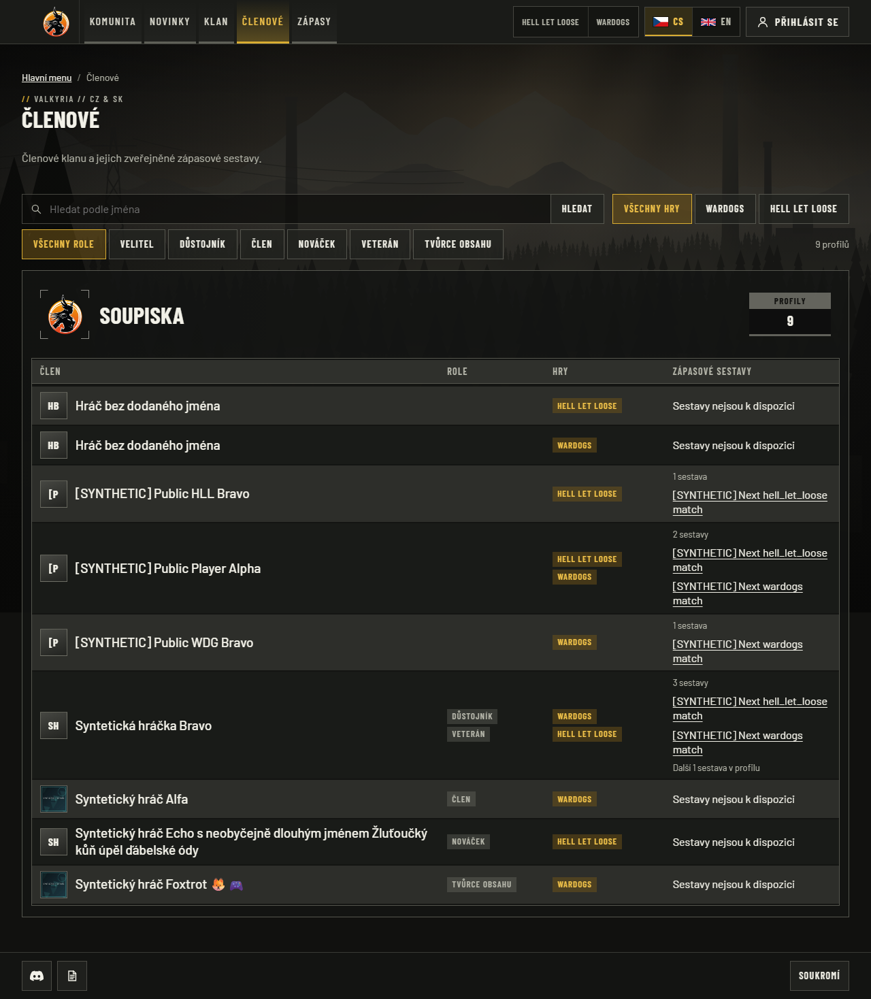

CS `/cs/members`, 1280px viewport; synthetic local application, source `b954ef5`, build `zxxN5ApXMysIhFQwZCyw8`. One directory composes approved personal profiles and supplied gaming names, deduplicated before shared search and filters.

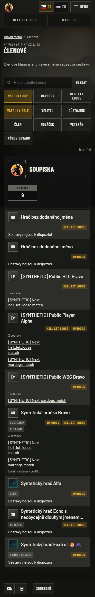

CS `/cs/members`, 390px viewport; synthetic local application, source `b954ef5`, build `zxxN5ApXMysIhFQwZCyw8`. One directory composes approved personal profiles and supplied gaming names, deduplicated before shared search and filters.

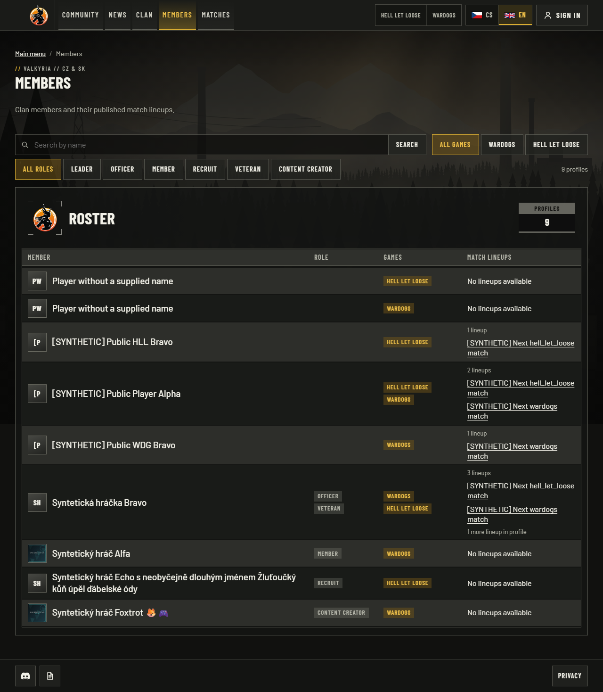

EN `/en/members`, 1280px viewport; synthetic local application, source `b954ef5`, build `zxxN5ApXMysIhFQwZCyw8`. One directory composes approved personal profiles and supplied gaming names, deduplicated before shared search and filters.

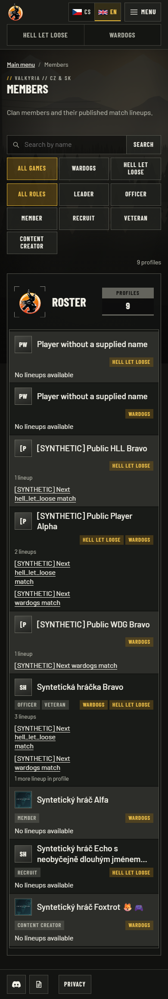

EN `/en/members`, 390px viewport; synthetic local application, source `b954ef5`, build `zxxN5ApXMysIhFQwZCyw8`. One directory composes approved personal profiles and supplied gaming names, deduplicated before shared search and filters.

</details>

<details>
<summary>Public player details — four inspected captures</summary>

Both game affiliations, published lineup links, distinct all-team totals and compact five-plus-25 match history. No personal biography or private identity is inferred.

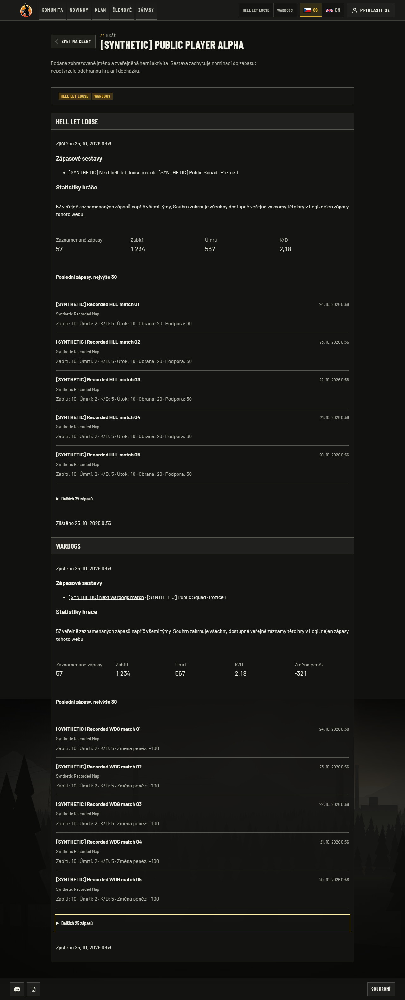

CS `/cs/players/<opaque-key>`, 1280px viewport; synthetic local application, source `b954ef5`, build `zxxN5ApXMysIhFQwZCyw8`. Both game affiliations, published lineup links, distinct all-team totals and compact five-plus-25 match history. No personal biography or private identity is inferred.

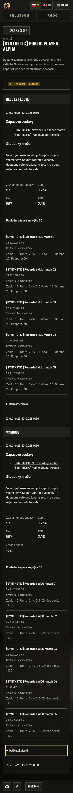

CS `/cs/players/<opaque-key>`, 390px viewport; synthetic local application, source `b954ef5`, build `zxxN5ApXMysIhFQwZCyw8`. Both game affiliations, published lineup links, distinct all-team totals and compact five-plus-25 match history. No personal biography or private identity is inferred.

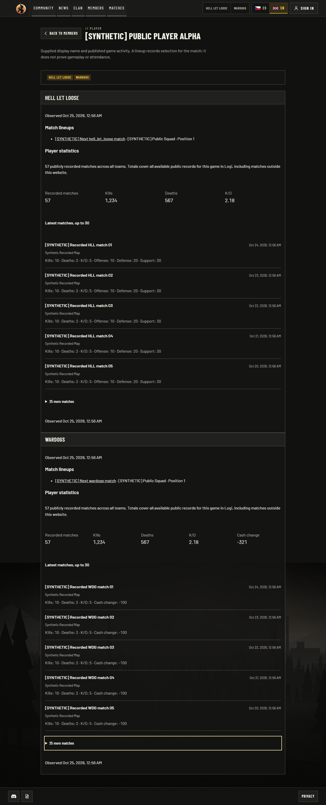

EN `/en/players/<opaque-key>`, 1280px viewport; synthetic local application, source `b954ef5`, build `zxxN5ApXMysIhFQwZCyw8`. Both game affiliations, published lineup links, distinct all-team totals and compact five-plus-25 match history. No personal biography or private identity is inferred.

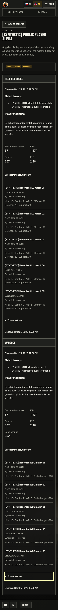

EN `/en/players/<opaque-key>`, 390px viewport; synthetic local application, source `b954ef5`, build `zxxN5ApXMysIhFQwZCyw8`. Both game affiliations, published lineup links, distinct all-team totals and compact five-plus-25 match history. No personal biography or private identity is inferred.

</details>

<details>
<summary>Hell Let Loose history — four inspected captures</summary>

Observed games, known score metrics, ranking coverage and expanded player detail; unsupported outcomes, factions and playtime remain unknown.

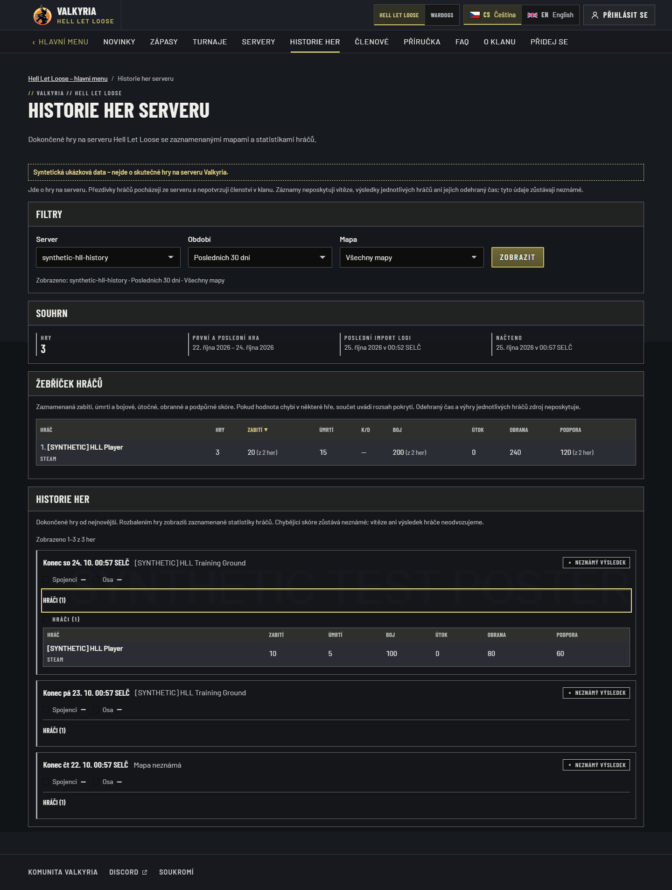

CS `/cs/hll/history`, 1440px viewport; synthetic local application, source `b954ef5`, build `zxxN5ApXMysIhFQwZCyw8`. Observed games, known score metrics, ranking coverage and expanded player detail; unsupported outcomes, factions and playtime remain unknown.

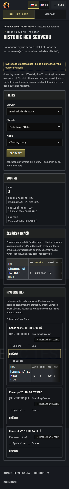

CS `/cs/hll/history`, 390px viewport; synthetic local application, source `b954ef5`, build `zxxN5ApXMysIhFQwZCyw8`. Observed games, known score metrics, ranking coverage and expanded player detail; unsupported outcomes, factions and playtime remain unknown.

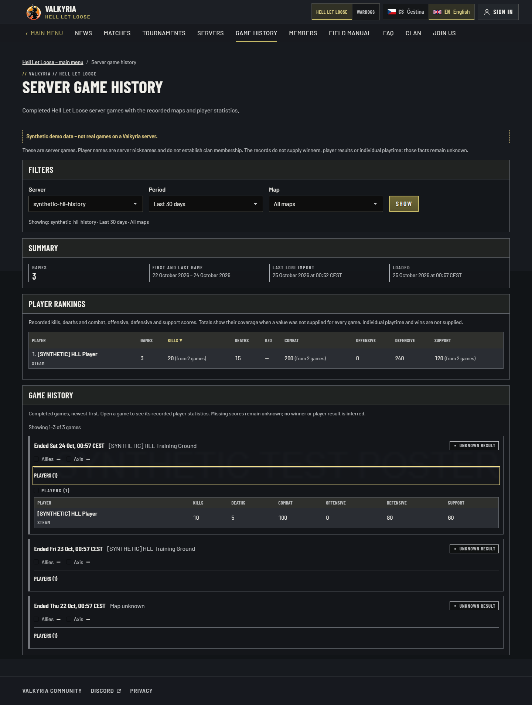

EN `/en/hll/history`, 1440px viewport; synthetic local application, source `b954ef5`, build `zxxN5ApXMysIhFQwZCyw8`. Observed games, known score metrics, ranking coverage and expanded player detail; unsupported outcomes, factions and playtime remain unknown.

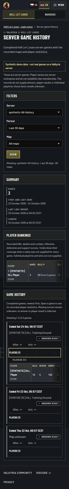

EN `/en/hll/history`, 390px viewport; synthetic local application, source `b954ef5`, build `zxxN5ApXMysIhFQwZCyw8`. Observed games, known score metrics, ranking coverage and expanded player detail; unsupported outcomes, factions and playtime remain unknown.

</details>

<details>
<summary>Wardogs history — four inspected captures</summary>

Game-scoped filters, faction summaries, sortable player ranking and expanded game detail using retained synthetic Warcon facts.

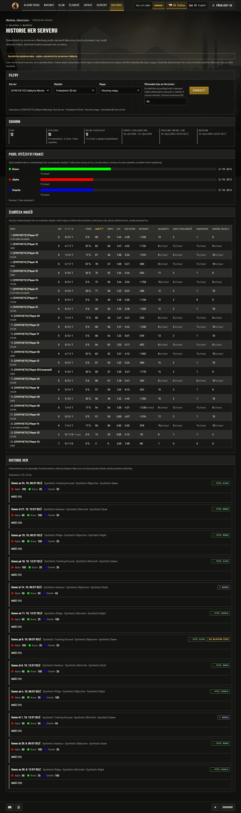

CS `/cs/wardogs/history`, 1440px viewport; synthetic local application, source `b954ef5`, build `zxxN5ApXMysIhFQwZCyw8`. Game-scoped filters, faction summaries, sortable player ranking and expanded game detail using retained synthetic Warcon facts.

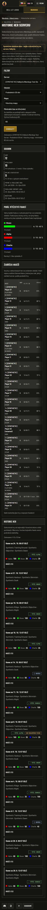

CS `/cs/wardogs/history`, 390px viewport; synthetic local application, source `b954ef5`, build `zxxN5ApXMysIhFQwZCyw8`. Game-scoped filters, faction summaries, sortable player ranking and expanded game detail using retained synthetic Warcon facts.

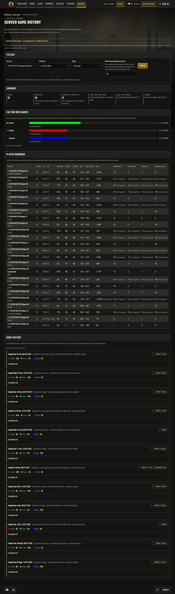

EN `/en/wardogs/history`, 1440px viewport; synthetic local application, source `b954ef5`, build `zxxN5ApXMysIhFQwZCyw8`. Game-scoped filters, faction summaries, sortable player ranking and expanded game detail using retained synthetic Warcon facts.

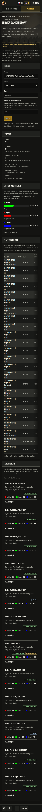

EN `/en/wardogs/history`, 390px viewport; synthetic local application, source `b954ef5`, build `zxxN5ApXMysIhFQwZCyw8`. Game-scoped filters, faction summaries, sortable player ranking and expanded game detail using retained synthetic Warcon facts.

</details>
