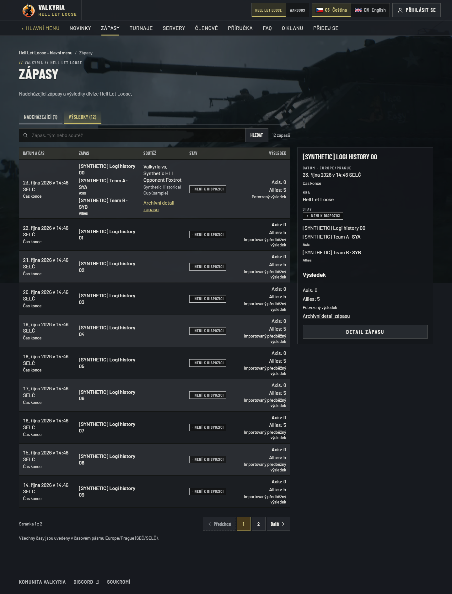
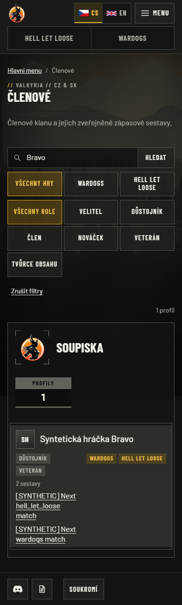
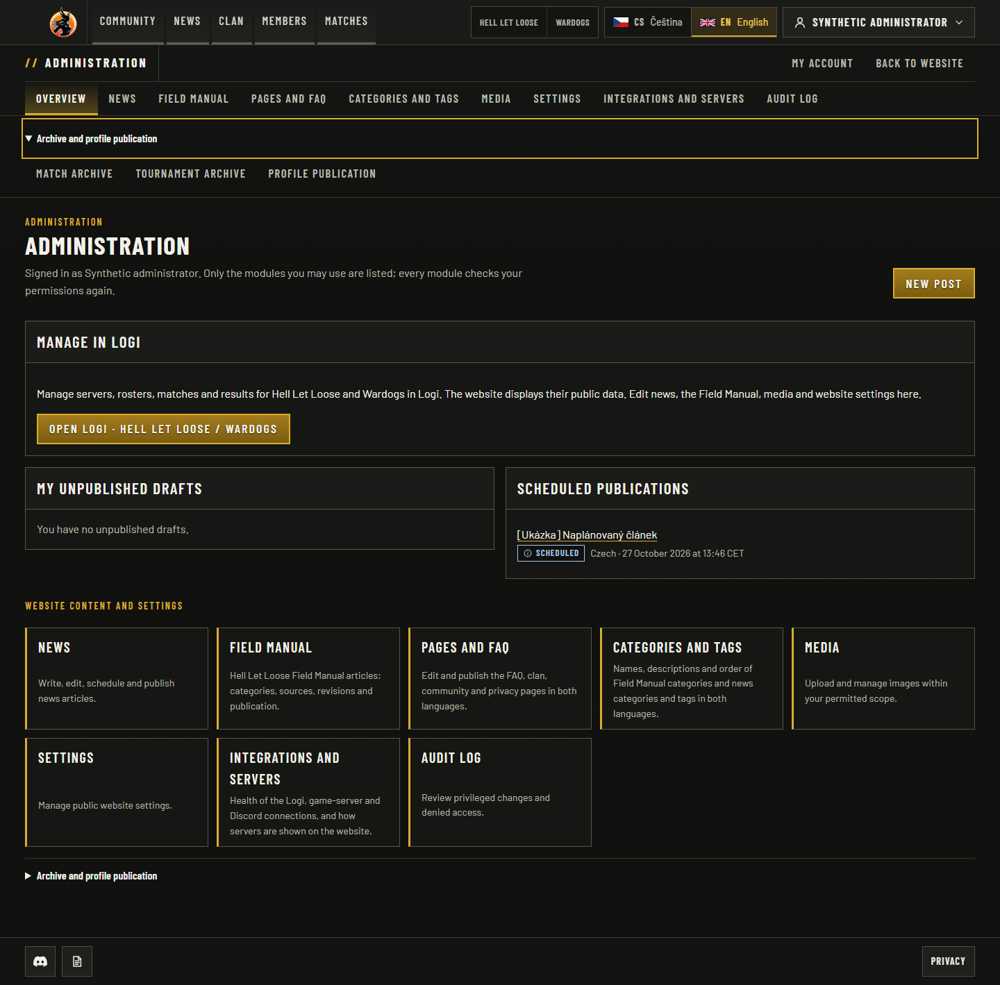

# Unified HLL/Wardogs website acceptance

Date: 2026-10-24. Branch: `feat/unified-logi-web`, based on main
`9b6ffd78ae2b02c57b390e582c42b39e4e8ebdcc`. Local Windows implementation and
synthetic acceptance; this record does not claim a production release.

## Delivered behavior

- Community, HLL and Wardogs match lists use one chronological browser with one
  search, view/game filter, total and page. Published Logi facts take priority over
  their explicitly linked archive rows. Unknown start times, zero/unknown scores,
  provisional/reviewed results and three-faction Wardogs results retain their meaning.
- Historical URLs, stored records, recaps and map rounds survive. A linked historical
  detail shows the current operational result once, without a competing summary score.
- Both game homes and the primary community hub select actual published upcoming
  fixtures. Unavailable sources do not manufacture a fixture.
- The ordinary member directory includes consented, identity-bound HLL/Wardogs match
  lineup links. Private member names, membership/groups/attendance and identifiers
  remain private. Duplicate imported positions do not inflate public counts.
- Servers read current Logi collections through bounded shared caches. HLL has an
  explicit scoped live-status/player adapter. Existing Wardogs Warcon and retained
  history readers remain available. Failures preserve honest unknown/stale states.
- Administration prioritizes editorial/configuration tools and a validated Logi entry.
  Archive/profile-publication tools remain keyboard-accessible in secondary disclosures.
  Backend permissions, consent and direct historical editor URLs are unchanged.

No SQL migration or Logi upstream source change is required. Existing source grants,
server publication mappings and provider collection still determine hosted behavior.

## Local checks

Environment: Node 24.21.0, pnpm 10.34.5 (repository pin), disposable PostgreSQL 18.4
with Unicode ICU locale on loopback, Playwright Chromium 1248. Test-only databases,
identities, source keys and observations are deliberately invented.

| Check | Command/scenario | Observed |
| --- | --- | --- |
| Install | `pnpm install --frozen-lockfile` | Passed; lockfile unchanged |
| Foundation | `node scripts/check-foundation.mjs` | Passed |
| Foundation behavior | `node --test scripts/tests/*.test.mjs` | 176 passed |
| Lint | `pnpm lint` | Passed |
| Types | `pnpm typecheck` | Passed |
| Unit | `pnpm test:unit` | 1,292 passed, including the final Warcon overview composition |
| PostgreSQL | `pnpm test:integration` | 529 passed |
| Production build | `pnpm build` | Passed, including bundled CLIs |
| Full browser regression | `pnpm test:e2e` | 272 passed; 166 documented opt-in capture/media cases skipped |
| Connected browser | `CAPTURE_EVIDENCE=1 pnpm --filter @valkyria/web exec playwright test -c playwright.logi.config.ts` | 17 passed; CS/EN at 1440/390, shared game filters, HLL/WDG homes and hub, current archive result, consented lineups, privacy and admin keyboard paths |
| Final server browser follow-up | Wardogs server and Warcon specs, `--project chromium --workers 1` after final server composition | 19 passed; no assertion or application change needed after a resource-pressure rerun; HLL live-player journeys also passed in the full regression |
| Hub geometry and navigation | Connected suite plus menu-shell and platform follow-ups after the final card-flow repair | 17 connected, 22 shell and 14 platform cases passed; next-match strips stay below full-width game entries at 1280px and 390px |
| Independent source review | Match paging/counts, scoped cache, public/private boundaries and admin guards | No actionable findings in reviewed integrated source |

The full browser run initially exposed two measurement assumptions in an existing
admin-shell test: a Chromium 43.99993896484375-pixel measurement of a computed 44px
target, and an action below the initial viewport after secondary navigation was added.
Measurements now normalize to 0.01px and the test scrolls the action into view. The
44px requirement, permission assertions and horizontal-scroll check are retained.
Connected acceptance initially retained old dual-list assertions; they were replaced
with explicit one-browser/search/page checks. Generic translation dictionary keys are
not treated as individual attendance data; unique private identities and public DTO
field boundaries are checked separately.

The local server also emitted intermittent Next.js closed-stream/Gzip-listener warnings
under automated navigation. The final browser cases passed; this record does not claim
those pre-existing runtime warnings were repaired.
One concurrent server follow-up recorded Chromium `ERR_NO_BUFFER_SPACE` in its
console-error assertion. All 19 cases subsequently passed serially with that assertion
retained; it was not treated as a successful first run.

## Inspected screenshots

Every capture below is an actual local application screenshot with synthetic fixtures,
reduced motion and the requested locale. No production member data or credentials appear.

| Capture | Caption |
| --- | --- |
| [HLL results, CS desktop](history-cs-1440.png) | One result browser, current reviewed/imported results and the linked historical detail |
| [HLL results, EN phone](history-en-390.png) | One search and pagination; all faction scores remain visible without page overflow |
| [Members, CS phone](members-cs-390.png) | One approved profile with HLL and Wardogs lineup links in the ordinary directory |
| [Members, EN desktop](members-en-1440.png) | Same consented cross-game profile and match links in the desktop roster |
| [Administration, CS phone](admin-cs-390.png) | Configured Logi operations, editorial controls and keyboard-accessible archive navigation |
| [Administration, EN desktop](admin-en-1440.png) | Editorial/settings/health primary navigation; historical tools remain secondary |
| [Community hub, CS](hub-cs-1280.png) | Actual next published match for each game |
| [Community hub, EN](hub-en-1280.png) | The same game-scoped next-match data with English interface |

## Separate hosted observations and activation limits

Read-only checks on 2026-10-24 observed the existing production container healthy
at source `9b6ffd78ae2b02c57b390e582c42b39e4e8ebdcc`. Public liveness/readiness and the HLL
match page returned 200. `valkyriawdg.cz` resolved to the canonical Wardogs section.
Both configured Logi sources already use `https://logibot.tech`; the former documented
origin redirects there. Authenticated server/event/member collection reads returned
200 for both games. A first HLL server observation was stale/unknown; a later read
was fresh/online. Wardogs remained stale/unknown, and its authorized Warcon live read
returned 200 with `freshness=unavailable` and no status. HTTP 200 therefore does not
establish healthy live telemetry or a complete import.

HLL production still selects CRCON and has no published Logi server mapping; Wardogs
selects Logi with one published mapped connection. The configured HLL data key receives
403 on `hll-live`. Full HLL activation requires the explicit grant and reviewed mapping
in the [HLL live runbook](../../integrations/logi/hll-live.md). No key was broadened,
provider setting changed, production database read/written, image published or service
restarted during this implementation.

Public member publication still requires consent and exact identity association.
Automatic publication of the entire private Logi directory is not enabled. External
League completed-match parsing remains unavailable in current Logi source; schema
compatibility does not invent placements or confirmed results.

Production publication/deployment and final hosted acceptance remain separate from
the local implementation and PR checks. Preserve the existing working site until an
accepted image and the applicable operator activation steps are available.
