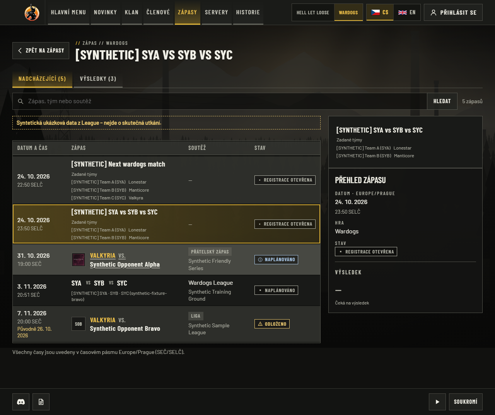
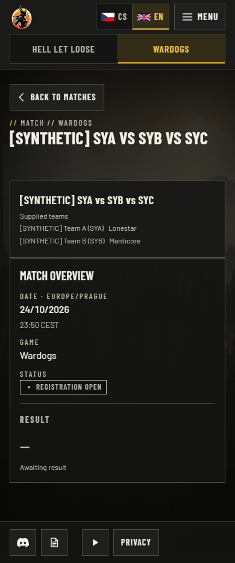

# Stable Wardogs match identity — 24 October 2026

Production review found a pending three-team Wardogs event with only two captured
team records and no result. Result count therefore cannot establish whether the
captured identity is complete. Every unlinked native Wardogs event now keeps its
exact supplied event title primary. All supplied teams remain secondary, labelled
“Supplied teams”, without VS or invented team/score attribution. HLL, reviewed
archive identities, absent teams, publication/freshness and result facts are unchanged.
The shared helper also supplies the match header and homepage next-match title.

## Local qualification

Tested application tree `7e8c329c77a69289e134888e41afa54eafa788a4`, based on
`360ffe2e822c0cbd41d32d13f09078d2c36da1f9`; Windows/Node24/pnpm10.34.5,
production build, Chromium and disposable loopback PostgreSQL, synthetic fixtures.
Full build/lint/typecheck and **1,395 unit tests /123 files** passed. The 59 focused
identity/rendering/homepage cases cover stable source identity at zero/two/three
result participants, pending and complete captures, original ordering, retained
facts, no invented third team or score, both locales and unchanged HLL/archive paths.

`CAPTURE_EVIDENCE=1 pnpm --filter @valkyria/web exec playwright test -c playwright.logi.config.ts`
passed **29/29** connected journeys. Four CS/EN ×1280/390 pending-WDG scenarios
verify the same exact title in the common list and detail, only two supplied facts,
an awaiting-result state, no horizontal overflow and no axe violations. Existing
long-name HLL geometry, linked timestamps, canonical redirects, approved lineups,
private-data exclusions and administration scenarios remain passing.

`/cs/wardogs/matches/logi/synthetic-pending-wardogs-identity`,1280×900 viewport,
full document: the exact three-team source title stays primary, two actual captured
teams remain explicitly secondary, and missing results stay awaiting result.

The same English detail at390×844/full document: all supplied facts are readable,
no fabricated third team or score, and no horizontal overflow. These are inspected
local synthetic captures, not production proof.

PR #117's exact-head CI passed, but its main/publisher runs were deliberately
cancelled before publication when this pending-event gap was found. That source was
not deployed. The combined correction merged as
`076ba9316ff0f8433dc01efc916a5962ca7ac184` and passed full exact-head/main/protected
publisher qualification. It was activated at20:40:17 UTC. Actual public/private and
visual production acceptance is in the [final record](../match-production-final-2026-10-24/README.md).
